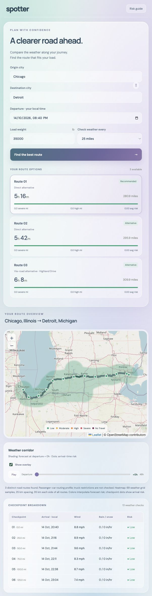

# Spotter — Weather-aware truck routing

React + Django assessment implementation. Live city geocoding, road alternatives, distance-based checkpoints, ETA-specific forecasts, load-sensitive risk classification and a spatial corridor heatmap with a 0–48 hour slider and playback.

## App preview

Live Chicago–Detroit route comparison with ETA checkpoints and the corridor weather heatmap.



## Run locally

Backend:
```sh
cd backend
python3 -m venv .venv
.venv/bin/pip install -r requirements.txt
.venv/bin/python manage.py runserver 127.0.0.1:8001
```
Frontend (separate terminal):
```sh
cd frontend
npm ci
npm run dev
```
Open http://127.0.0.1:5173. Vite proxies `/api` to Django. Without a key, public Open-Meteo services are used. To select WeatherAPI for forecasts and city search, set the server-only `WEATHERAPI_KEY` environment variable or save the key in `~/.weatherapi-key` (permissions `600`). Never commit the key or put it in a frontend environment variable. Restart the backend after configuration.

## Validation
```sh
cd backend
.venv/bin/python -m unittest discover -s . -p 'test_*.py'
.venv/bin/python manage.py check
cd ../frontend
npm run build
```

## Rules and assumptions

- Units: wind mph, rain/snow inches/hour, load pounds. Open-Meteo rain + showers are converted from mm; snowfall from cm. WeatherAPI uses hourly wind_mph, precip_mm and snow_cm. Its total precipitation is conservatively compared to the rain thresholds (it is not a separate rain-only measurement); its hourly maximum wind can also make risk more conservative.
- Shared rain/snow threshold boundaries use the higher risk (0.25 in/hr rain is High); exactly 1 inch rain and 3 inches snow remain Severe, as the spec explicitly uses `>` for No Travel.
- Wind uses continuous thresholds 25/35/45/55. Load overrides use strictly greater than 30,000 / 40,000 lb.
- Checkpoints interpolate full route geometry at 10/25/50 mile intervals plus both endpoints. ETA uses OSRM per-segment durations, not straight-line distance or average speed.
- Open-Meteo samples use the enclosing hour ending at the forecast timestamp. WeatherAPI timestamps use time_epoch converted to UTC and select the hour starting at that timestamp. Missing/out-of-range data fails visibly, never substitutes Low risk.
- Segment exposure conservatively uses the worse adjacent checkpoint risk. Average risk is distance weighted (0–4).
- No Travel routes are excluded. Remaining routes are ranked lexicographically by Severe miles, High miles, average risk, then travel duration.
- Departure is timezone-aware. Open-Meteo permits departures within four days using a seven-day forecast. WeatherAPI requests only three calendar days, compatible with its Free plan: departures are capped at 24 hours ahead and actual coverage is validated for every arrival and the full 48-hour overlay. Near the end of the forecast window, an earlier departure may be required; missing hours are never invented.

## Implementation notes and limitations

- Requests three direct OSRM alternatives, then tries up to six perpendicular intermediate waypoints to fill missing options. Geometry-cell overlap rejects duplicates; distance/duration over 2.2× the base route is rejected. Successful Chicago–Detroit verification returns three routes. Some road networks cannot provide three valid routes; the API returns `complete: false` and an honest count in that case.
- OSRM's public driving profile is passenger-car based, not truck-restriction aware. Breaks and traffic aren't modeled.
- Full corridor heatmap samples a geographic grid within 35 km of all routes. Starts at 25 km spacing and adapts to at most 180 nodes. All 49 hourly risk values are prefetched. Canvas inverse-distance interpolation is clipped to buffered route geometry and redraws on pan/zoom/resize. It is an interpolated forecast risk field, not radar or an exact storm boundary.
- Origin and destination fields show debounced city suggestions with region and country. Selecting a suggestion preserves its coordinates; editing the text clears the selection. Unselected typed names use the top geocoding match.
- Public API availability and rate limits apply. Open-Meteo requests are batched; WeatherAPI Free-plan requests use individual locations with at most four concurrent requests. Duplicate coordinates are reused and forecasts cached for one hour on disk. Other provider responses are cached for ten minutes. Provider HTTP 429 responses trigger a cooldown using Retry-After when supplied; otherwise a conservative delay is used. Caching reduces repeat requests but cannot remove an exhausted provider quota. Multi-instance production needs a shared cache, request throttling, authentication as appropriate, and a job queue for long trips.

## Deployment

The Dockerfile builds React and serves it with Django using WhiteNoise and Gunicorn at one origin. The included `render.yaml` configures a Docker web service on Render, generates a secret, and uses `/api/health` for health checks.

For other Docker hosts, set `DEBUG=0`, `DJANGO_SECRET_KEY` to a random secret, and `ALLOWED_HOSTS` to the deployment hostname. Configure HTTPS at the reverse proxy. Set `TRUST_PROXY=1` only behind a trusted proxy that sets the forwarded-protocol header. The server reads its port from `PORT` (default 8000).

## References
- https://www.weatherapi.com/docs/forecast-api/
- https://www.weatherapi.com/pricing.aspx
- https://open-meteo.com/en/docs
- https://open-meteo.com/en/docs/geocoding-api
- https://project-osrm.org/docs/v5.24.0/
